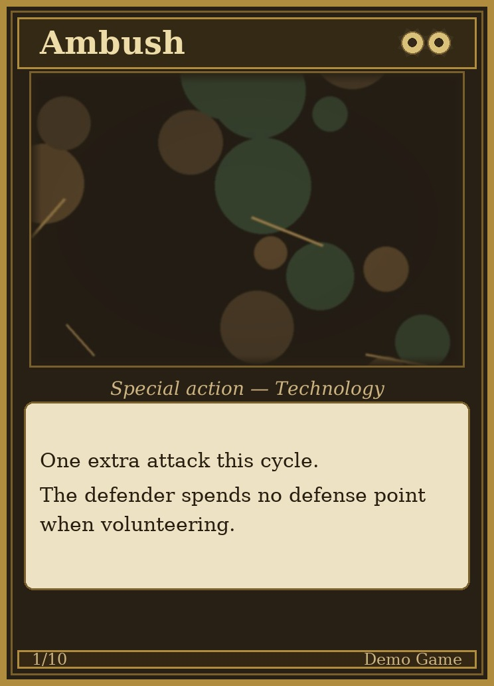
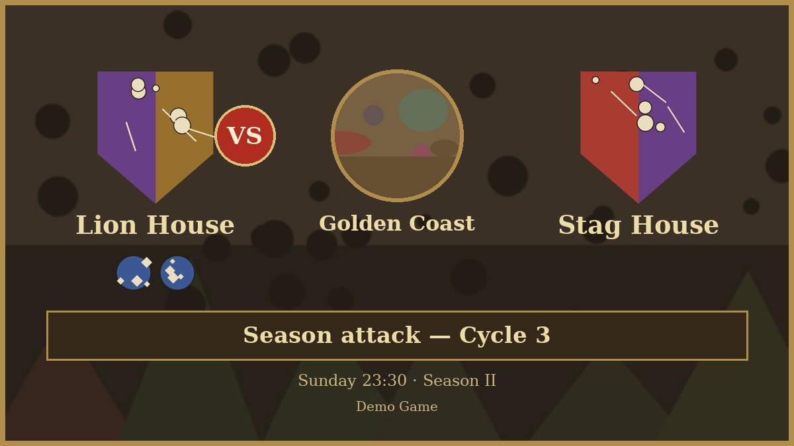
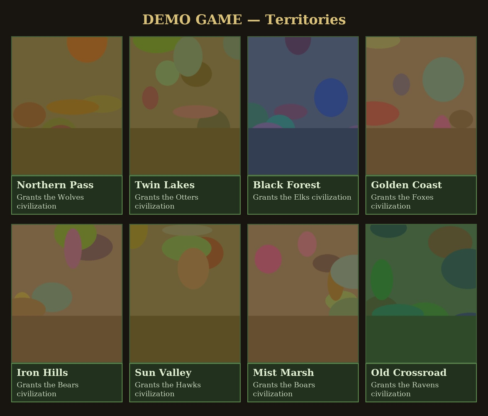
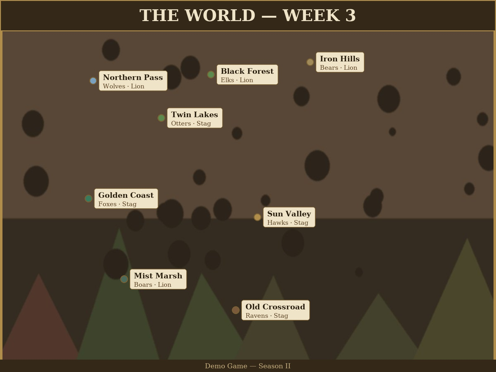
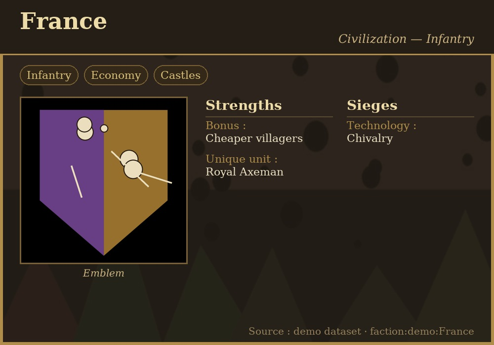
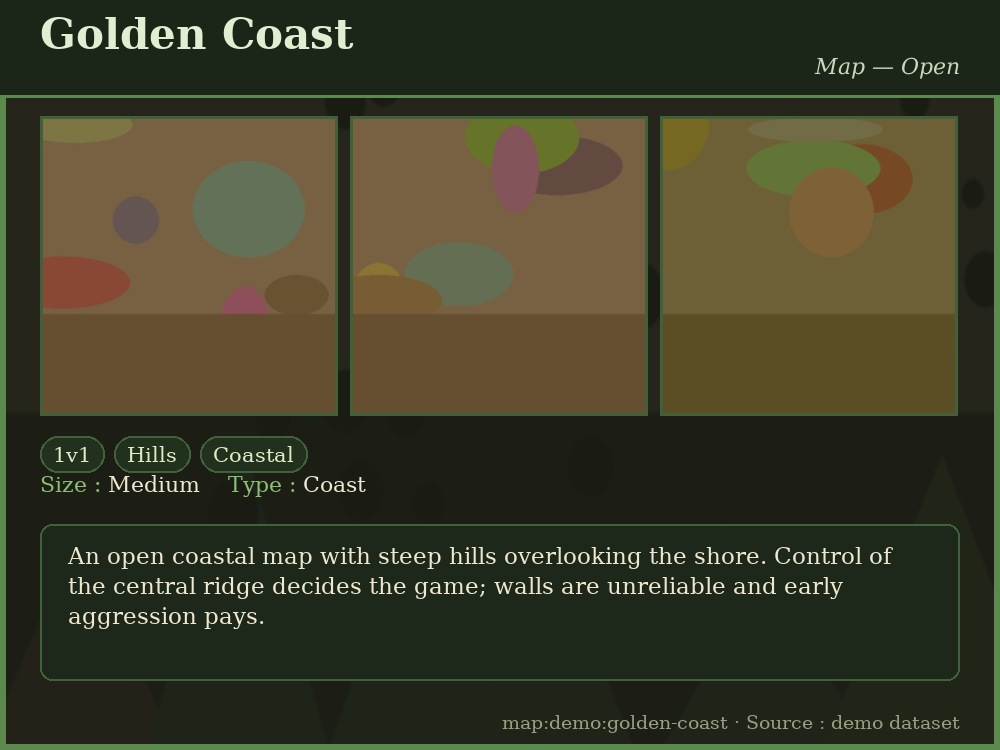
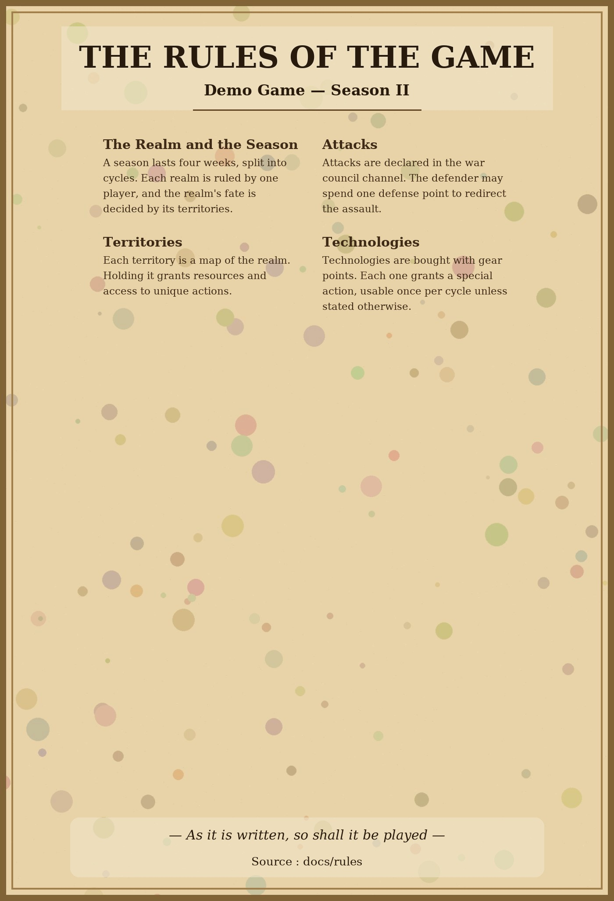

# visual-generator

A generic, data-driven visual generator: **JSON + template + art + text
sections**. Any visual — TCG card, match announcement, gallery,
annotated world map, parchment rules poster — is defined by:

- a **JSON data file** — the content (names, texts, numbers, image paths);
- a **template** — a Python layout module in `templates/`;
- **art** — image-model generated pictures (or real game assets),
  never carrying text;
- **text sections** — drawn by the engine with a real vector font,
  which makes every output OCR-verifiable.

Any game can use it: the engine and templates are project-agnostic,
and all game-specific content lives in the JSON data files of the
consuming project.

## Examples

### TCG card (`card_tcg`)



Cost is drawn as repeated gear icons (Magic-style currency icons).

### Match announcement (`match_announcement`)



Attacker's civilizations under the crest, battle map in the central
medallion.

### Gallery (`gallery`)



### Annotated world map (`world_map`)



Regions pinned on the map art at their geographic positions.

### Info card (`info_card`)



One image, tag chips, structured label/value columns — the profile /
civilization / player card case.

### Media card (`media_card`)



Image strip (up to 4), tags, facts line, synthesized description —
the map / media-heavy post case.

### Parchment rules poster (`parchment_poster`)



Texture background, auto-fitted multi-column rules text.

## Agent skill

This repository ships the canonical agent skill for the library:
[`.agents/skills/visual-generator/SKILL.md`](.agents/skills/visual-generator/SKILL.md)
(plus its [`scripts/render_and_check.py`](.agents/skills/visual-generator/scripts/render_and_check.py)
batch helper). Any project using the library should point its agents
at that skill: it documents the install, the CLIs, the per-template
JSON schemas, the OCR validation contract and the known pitfalls —
everything needed to reproduce the reference rendering.

## The one hard rule

**The image model never renders text.** Image models produce
convincing-looking but misspelled pseudo-text. Every word on a visual
is drawn by the engine from the JSON — the only way to guarantee
correct text and prove it by OCR.

## Project layout

```
├── AGENTS.md               ← agent instructions (rules, workflow)
├── .agents/skills/         ← agent skill (visual generation pipeline)
├── engine/render.py        ← core renderer (templates, palettes, fonts)
├── tools/ocr_check.py      ← OCR validation (fail-closed)
├── tools/make_demo_assets.py ← procedural demo art (no text, no model)
├── templates/              ← one layout module per visual kind
│   ├── card_tcg.py           TCG card (fixed anatomy, gear-icon costs)
│   ├── match_announcement.py Discord-sized X-vs-Y banner
│   ├── gallery.py           N-items grid with captions
│   ├── world_map.py         annotated map (geo-placed region pins)
│   ├── parchment_poster.py  rules poster on a parchment texture
│   ├── info_card.py         one image + dense info columns (profiles)
│   └── media_card.py        image strip + tags + description (maps)
├── data/                   ← JSON examples (source of truth per visual)
└── examples/               ← rendered outputs + their assets
```

## Usage

Install (pip or uv):

```bash
uv add visual-generator        # or: pip install visual-generator
```

CLIs provided by the package:

```bash
vg-demo-assets                                   # demo art -> examples/assets/
vg-render --data data/card_ambush.json           # render
vg-ocr-check --data data/card_ambush.json       # validate (fail-closed)
```

From a repo checkout the module paths still work
(`python engine/render.py --data …`, `python tools/ocr_check.py …`).

The `template` key selects the layout module. Each template documents
its JSON schema in its docstring; each `data/*.json` is a working
example.

## Principles

1. **The image model never renders text** (see above).
2. **Data is the source of truth** — edit the JSON, re-render, never
   edit the image.
3. **Templates own the layout** — zone positions are fixed fractions
   of the canvas; art is center-cropped into its window and never
   shifts the text zones.
4. **Every output must pass OCR** before delivery.
5. **Assets are content, not decoration** — the JSON references the
   real game assets (crests, map thumbnails, civilization icons); the
   renderer places them, it never invents them.

## Status

Prototype, validated on a 10-card technology deck, a 48-card
territory deck, a parchment rules poster and the five templates
above, with project-agnostic data. Roadmap: extract a proper
pip-installable library (see the issues) with a plugin API for
templates and art providers.

License: MIT.
